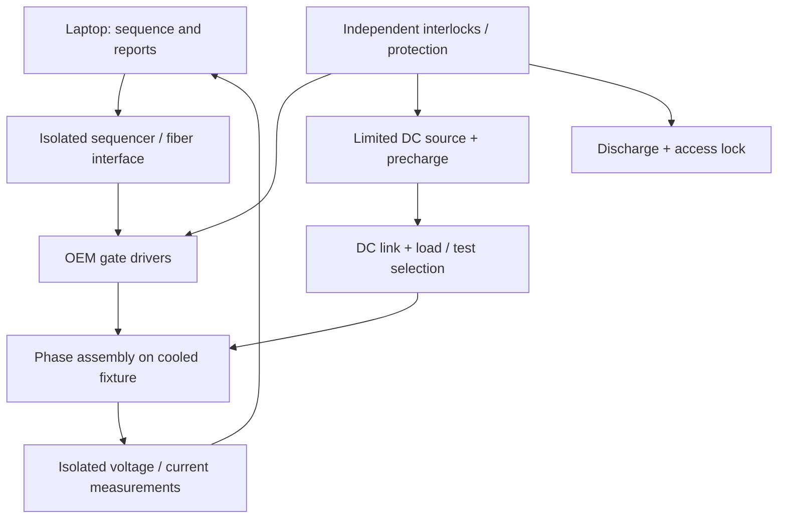

# Physical prototype design proposal

## Architecture and interfaces

The station separates three functions: independent protection and access control; electrical stimulus/measurement; laptop sequencing and reporting. The laptop is not in the sub-microsecond gate-protection path.

All switching between low-energy instruments, upper/lower DPT connections and fault fixtures must occur de-energized, with interlocked selection feedback. Do not connect a leakage instrument to a charged pulse bus. Keep measurement/control wiring separate from the commutation loop. The source presentation lacks an approved pinout, so this proposal identifies interfaces by function rather than inventing connector pin numbers.

| Interface | Required definition before construction |
|---|---|
| Power terminals | DC+, DC−, phase node, current ratings, terminal torque, clearances and keyed adapter geometry |
| Gate driver supply | 100 Vrms / 25 kHz waveform, isolation, tolerances, startup sequence, real power and channel count |
| Optical control/status | Fiber type, wavelength, connector, coding, polarity, heartbeat, delay and loss behavior |
| Thermal | Cold-plate contact, coolant medium, temperature/flow/pressure range and leakage detection |
| Measurements | VCE, VGE, IC and fault/status trigger; isolated channels, sensor bandwidth, loading, calibration and deskew |
| Station safety | Door/guard lock, fixture latch, connector feedback, earth verification, E-stop, coolant and isolation feedback |
| Reporting | Serial/operator identity, timestamp, released profile revision, calibration references and full result/trace archive |

## Concept ratings and sizing

The delivered default circuit is a **400 V / roughly 60 A limited-pulse prototype**. Its comparison envelope extends to 600 V only where currents and component ratings remain valid. It is not a proposed final locomotive full-power rating.

- DC-link capacitor: 470 µF at 400 V stores **37.6 J**; at 600 V it stores **84.6 J**. Select voltage, ripple, pulse-current, lifetime and fault-energy ratings with appropriate engineering margins; use short laminated connections. The simulation's editable 1400 V ceiling is exploratory, not the candidate hardware's rating.
- Load: 500 µH at 80 A stores **1.6 J**. Specify saturation above the maximum approved test current, insulation, pulse energy, repeat rate and measured DCR; the fault experiment also needs a separately rated limited-energy path.
- Default 1 kΩ DC dump dissipates **160 W initially at 400 V** and **360 W at 600 V**, with 37.6/84.6 J per complete discharge. Resistor pulse-energy, voltage, repetition, mounting and open-circuit detection matter as much as continuous wattage. The budget includes redundant discharge/monitoring engineering; the virtual model contains one declared discharge path.
- Default 100 Ω precharge path and current-limited supply are modeled by a timing allowance. Select resistor/contactor ratings from the actual charge trajectory and worst-case stored energy; verify welded-contact feedback and source isolation.
- Driver excitation: provide the actual OEM 100 Vrms / 25 kHz source with isolation and power margin. This is a custom high-frequency source requirement, not an ordinary 100 V mains outlet. Two channels need a reviewed aggregate power allocation; the presentation's 20 W wording must be clarified.
- Use a local hardware pulse generator or FPGA with independent inhibit and bounded pulse width. A laptop operating system is unsuitable for precision µs gate timing or fault protection.
- Measurement acquisition should resolve the chosen 10 ns slew aperture. A 350 MHz scope with appropriately sampled channels is a starting point; the complete probe/shunt chain, bandwidth, common-mode rejection and deskew determine usable accuracy. A probe's “1500 V differential” label alone does not approve its common-mode/transient installation.
- Use a wideband isolated gate measurement suitable for high-side common-mode slew, a suitably rated collector differential probe, and a qualified low-inductance current shunt or wideband pulse-current sensor. Reserve a channel for trigger/status; additional simultaneous quantities may require more channels or repeated acquisitions.
- Static 1200 V blocking leakage needs a dedicated current-limited source/SMU and guarded measurement. It is not supplied by the 600 V charging supply. The 80 A conduction point requires an appropriately controlled brief-current source or approved pulse method and Kelvin voltage sensing.

## Mechanical layout and serviceability

`cad/IGBT_Test_Cell.step` is an editable 608-solid concept assembly. The cabinet envelope is roughly 1800 × 850 mm in plan with roof around 1714 mm; dimensions are conceptual. The DUT fixture, busbar paths, instruments, controls and operator display are included. `static/model.html` is the bundled interactive geometry.

The nominal 25 kg module weighs approximately 245 N. Specify a fixture/slide working load of at least 75 kg as a **proposal** to allow handling margin, then verify cantilever loading, fasteners, stops, anti-tip stability, center of mass and proof-load criteria for the actual assembly. This proposal does not certify a factor of safety or compliance. Provide a lift aid, keyed adapter, repeatable cold-plate contact, captive restraints and an access position that does not strain power/fiber/coolant connections.

Keep HV compartments guarded, provide tool-controlled service access and independent bus-voltage indication, and route coolant away from energized terminals. Actual clearances/creepage depend on approved voltage, pollution, altitude, materials and insulation coordination. They cannot be derived from a visual render. The CAD has not been checked for structural stress, arc containment, electrical fields or validated assembly tolerances.

## Independent protection requirements

Require fail-safe gate inhibit, desaturation/overcurrent action, source isolation, discharge, lock feedback and residual-voltage monitoring independent of the laptop. Loss of control power or communication must lead to the reviewed safe state. Define how stored energy is handled after each fault, including failed discharge, welded contactor, broken sensor and interrupted cooling. Document proof-test and recovery steps before allowing access.

The virtual model represents Boolean startup interlocks, idealized local desaturation, operator gate inhibit and one discharge path. It does not claim safety-integrity performance, functional-safety certification, redundant hardware verification or a complete failure-mode analysis.

## Design freeze checklist

Construction release requires actual assembly drawings/part numbers, an approved schematic/netlist and connector schedule, insulation coordination, thermal/mechanical calculations, component pulse/SOA ratings, fault containment review, protection test evidence, measurement uncertainty, and the released operating procedure. Those are specific engineering dependencies, not hidden software features promised by this package.

The explicit virtual companion-short experiment is for evaluating the modeled protection response. It is not approval to apply a full-energy short to every production module. The real screening procedure must use an OEM-approved limited-energy or driver fault-stimulation method and reserve any destructive/withstand qualification for authorized samples and fixtures.
